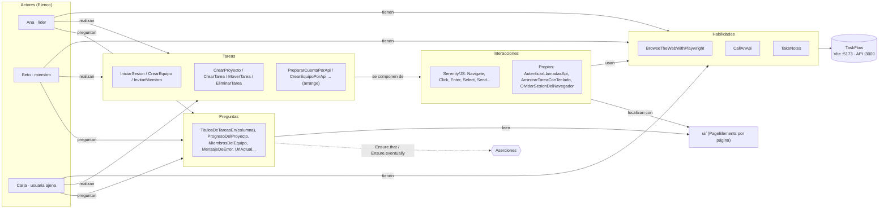

# Pruebas E2E de TaskFlow con el patrón Screenplay

Automatización de recorridos de extremo a extremo de **TaskFlow** (Kanban colaborativo) aplicando el
patrón **Screenplay** con [Serenity/JS](https://serenity-js.org) 3.48.2 sobre **Playwright Test** 1.63.0.

Los escenarios están escritos en el lenguaje de las personas usuarias: *actores* que tienen *habilidades*,
realizan *tareas* compuestas de *interacciones* y responden *preguntas* sobre lo que ven, sobre las que se
hacen *aserciones* (`Ensure`).

```ts
await actorCalled('Ana').attemptsTo(
    CrearTarea.titulada('Diseñar la pantalla de inicio'),
    MoverTarea.llamada('Diseñar la pantalla de inicio').aLaColumna('Hecho'),
    Ensure.eventually(ProgresoDelProyecto(), equals(50)),
);
```

## Correspondencia del patrón



| Elemento Screenplay | Dónde | Qué contiene |
|---|---|---|
| **Actor** | `src/screenplay/actores/Elenco.ts` | `Cast` con **Ana** (líder; usa la página de Playwright, así su vídeo/traza quedan en el informe), **Beto** (miembro) y **Carla** (ajena), cada uno con su propio contexto de navegador y sesión. |
| **Habilidad (Ability)** | `Elenco.ts` | `BrowseTheWebWithPlaywright` (navegar), `CallAnApi` (preparar datos contra la API REST), `TakeNotes` (recordar credenciales, ids de equipo/proyecto/tarea). |
| **Tarea (Task)** | `src/screenplay/tareas/` | Acciones de negocio: `RegistrarseEnTaskFlow`, `IniciarSesion`, `IntentarIniciarSesion`, `CerrarSesion`, `CancelarCierreDeSesion`, `CrearEquipo`, `AbrirEquipo`, `InvitarMiembro`, `BuscarPersonaParaInvitar`, `QuitarMiembro`, `CrearProyecto`, `AbrirTablero`, `CrearTarea`, `RellenarNuevaTarea`, `MoverTarea`, `EliminarTarea`, `DeshacerUltimaAccion`, `BuscarTarea`, `AbrirPreferencias`, `CambiarPreferencias`, `RestablecerPreferencias` y las de preparación por API: `RegistrarUsuarioPorApi`, `IniciarSesionPorApi`, `PrepararCuentaPorApi`, `CrearEquipoPorApi`, `AnadirMiembroPorApi`, `CrearProyectoPorApi`, `CrearTareaPorApi`. |
| **Interacción (Interaction)** | `src/screenplay/interacciones/` + Serenity/JS | De Serenity/JS: `Navigate`, `Click`, `Enter`, `Clear`, `Select`, `Send`, `Wait`. Propias: `AutenticarLlamadasApi` (añade el token Bearer), `ArrastrarTareaConTeclado` (arrastre accesible Espacio + flechas), `OlvidarSesionDelNavegador` (limpia el almacenamiento local). |
| **Pregunta (Question)** | `src/screenplay/preguntas/` | `MensajeDeError`, `MensajeDeCuentaCreada`, `TitulosDeTareasEn(columna)`, `TitulosDeTareasVisibles`, `ColumnasDelTablero`, `ProgresoDelProyecto`, `ContadorDeResultados`, `MiembrosDelEquipo`, `EquiposVisibles`, `TituloDeLaPagina`, `UrlActual`, `EncabezadoPrincipal`, `AvisoVisible`, `ModoDeContraste`, `TamanoDeTexto`, `ValorEnAlmacenamientoLocal`. |
| **Elementos de UI** | `src/screenplay/ui/` | `PageElement`/`PageElements` agrupados por página, localizados por rol y nombre accesible, etiqueta o texto (sin clases de estilo frágiles). |
| **Expectativa propia** | `src/screenplay/expectativas/estaVisible.ts` | Espera a que el elemento esté visible según Playwright (la `isVisible()` de Serenity exige además que esté en el viewport y sin nada encima, lo que daba falsos negativos con avisos emergentes o texto agrandado). |
| **Escenarios** | `specs/*.spec.ts` | 18 casos (SP-01…SP-18), exitosos y alternativos, con aserciones `Ensure.that` / `Ensure.eventually`. |

## Casos cubiertos

| Id | Caso | Tipo | Actores |
|---|---|---|---|
| SP-01 | Registro exitoso e inicio de sesión | exitoso | Ana |
| SP-02 | Registro con correo duplicado | alternativo | Ana |
| SP-03 | Registro con contraseñas que no coinciden | alternativo | Ana |
| SP-04 | Inicio de sesión fallido muestra alerta | alternativo | Ana |
| SP-05 | Ruta protegida sin sesión redirige a /login | alternativo | Ana |
| SP-06 | Cerrar sesión con confirmación (cancelar y confirmar) | exitoso | Ana |
| SP-07 | La líder crea un equipo e invita a un miembro | exitoso | Ana, Beto |
| SP-08 | Invitar un correo no registrado | alternativo | Ana |
| SP-09 | Crear proyecto genera las 3 columnas | exitoso | Ana |
| SP-10 | Quitar miembro con confirmación y deshacer | alternativo | Ana, Beto |
| SP-11 | Crear tareas, mover a «Hecho» y subir el progreso | exitoso | Ana |
| SP-12 | Crear tarea sin título | alternativo | Ana |
| SP-13 | Eliminar tarea con confirmación y deshacer | alternativo | Ana |
| SP-14 | Búsqueda tolerante a tildes y errores | exitoso | Ana |
| SP-15 | Mover tarea arrastrándola con el teclado | exitoso | Ana |
| SP-16 | Beto ve la tarea de Ana y su cambio de columna (multi-actor) | exitoso | Ana, Beto |
| SP-17 | Usuaria ajena no puede ver el tablero | alternativo | Ana, Carla |
| SP-18 | Alto contraste, tamaño de texto y restablecer | exitoso | Ana |

El objetivo y el resultado esperado de cada caso están en `catalogo/casos.json`; el resultado **obtenido**
y el **estado** se generan a partir de la ejecución real (reporter JSON de Playwright).

## Requisitos y ejecución

* Node.js 20+, Google Chrome instalado (se usa `channel: 'chrome'`, no se descargan navegadores) y
  Java 17+ (solo para el informe HTML de Serenity BDD).
* Backend en `http://localhost:3000` y frontend en `http://localhost:5173` en marcha
  (se pueden cambiar con `TASKFLOW_API_URL` y `TASKFLOW_URL`).

```bash
cd pruebas/e2e-screenplay
npm install
npx serenity-bdd update     # descarga (una vez) el CLI de Serenity BDD
npm test                    # pruebas + informe Serenity BDD + resumen y evidencias
npm run test:headed         # ver el navegador (1 worker)
npm run report              # regenerar el informe Serenity BDD y el resumen
npm run report:playwright   # abrir el informe HTML de Playwright
```

Variables útiles: `WORKERS` (por defecto 2), `RETRIES` (por defecto 1) y `FOTOS=interacciones` (una foto de Serenity por interacción).

## Datos de prueba

La base de datos es compartida, así que cada escenario crea **sus propios** usuarios, equipos y proyectos
con un sufijo único (`Date.now()`), y prepara los datos que no son objeto de la prueba **por API**
(`CallAnApi`), dejando la interfaz para el comportamiento que se valida. Los inicios de sesión fallidos usan
correos únicos para no activar el bloqueo de 5 intentos por correo.

## Evidencias

`npm test` deja en `pruebas/evidencias/screenplay/`:

* `resumen.json`: totales, inventario del patrón y, por caso, objetivo, esperado, **obtenido** (aserciones
  verificadas o error real), estado y rutas de evidencia.
* `reporte-serenity/index.html`: documentación viva de Serenity BDD con cada tarea, interacción y aserción y
  capturas de los fallos (Photographer `TakePhotosOfFailures`; con `FOTOS=interacciones` se fotografía cada interacción).
* `reporte-playwright/index.html`: informe HTML de Playwright con captura, vídeo y traza de cada caso.
* `capturas/SP-xx.png`, `videos/SP-xx-*.webm` (incluidos los de Beto y Carla), `trazas/SP-xx-trace.zip`
  (casos SP-11, SP-16 y cualquier caso fallido; se abren con `npx playwright show-trace`).
* `resultados-playwright.json`: resultados en bruto (versión ligera).

## Escenarios Gherkin (Cucumber + Serenity/JS) sobre el mismo patrón Screenplay

Además de las especificaciones de Playwright Test (`specs/`), la carpeta `features/` contiene **escenarios en lenguaje
Gherkin en español** (`# language: es`) ejecutados con **Cucumber 11** y el adaptador `@serenity-js/cucumber`. Los pasos
*Dado / Cuando / Entonces / Y* no contienen lógica de automatización: cada uno delega en las **mismas tareas,
interacciones y preguntas Screenplay** de `src/screenplay/` que usan los casos SP-01…SP-18.

```text
features/autenticacion.feature          features/step_definitions/acceso.ts           src/screenplay/tareas/TareasDeAcceso.ts
  Cuando Ana se registra desde el   →   Cuando('{word} se registra desde el     →   RegistrarseEnTaskFlow.con(credenciales)
  formulario con sus datos                formulario con sus datos', nombre =>        (Navigate, Enter, Click sobre PaginaRegistro)
                                          actorCalled(nombre).attemptsTo(...))
  Entonces Ana llega a la página    →   Entonces('{word} llega a la página      →   Ensure.eventually(EncabezadoPrincipal(), equals(...))
  "Mis equipos"                           {string}', ...)                             Ensure.that(UrlActual(), equals('/'))
```

| Pieza | Dónde | Qué hace |
|---|---|---|
| Características (`.feature`) | `features/*.feature` | 4 características, 12 escenarios **GH-01…GH-12** (incluye un *Esquema del escenario* con *Ejemplos*), etiquetados `@exitoso`, `@alternativo` o `@error` y por funcionalidad (`@autenticacion`, `@equipos`, `@proyectos`, `@tareas`, `@usuarios`). |
| Definiciones de pasos | `features/step_definitions/*.ts` | Expresiones Cucumber (`{word}` = actor, `{string}`, `{int}`) que llaman a `actorCalled('Ana').attemptsTo(Tarea…, Ensure.that(Pregunta…))`. |
| Contexto del escenario | `features/support/contexto.ts` | Credenciales y nombres únicos generados en el escenario, compartidos entre pasos. |
| Configuración Serenity/JS | `features/support/serenity.config.ts` | Lanza Chrome (Playwright), configura el elenco `ElencoGherkin` (un contexto de navegador por actor), los *reporters* (consola, Serenity BDD, fotos) y una captura final por escenario. |
| Elenco | `src/screenplay/actores/ElencoGherkin.ts` | Mismas habilidades que en Playwright Test: `BrowseTheWebWithPlaywright`, `CallAnApi`, `TakeNotes`. |
| Configuración Cucumber | `cucumber.js`, `tsconfig.cucumber.json` | Carga los `.ts` con `tsx`, formatos `@serenity-js/cucumber`, JSON y HTML. |
| Catálogo | `catalogo/gherkin.json` | Objetivo y resultado esperado de cada escenario (el obtenido se genera de la ejecución real). |

### Escenarios

| Id | Característica | Escenario | Tipo |
|---|---|---|---|
| GH-01 | Acceso | Registro exitoso e inicio de sesión | exitoso |
| GH-02 | Acceso | Registro con correo ya existente | alternativo |
| GH-03 | Acceso | Inicio de sesión con contraseña incorrecta (esquema, ejemplo 1) | error |
| GH-04 | Acceso | Inicio de sesión con correo no registrado (esquema, ejemplo 2) | error |
| GH-05 | Acceso | Ruta protegida sin sesión redirige a /login | error |
| GH-06 | Equipos | La líder crea un equipo e invita a un miembro | exitoso |
| GH-07 | Equipos | Invitar un correo no registrado | alternativo |
| GH-08 | Proyectos | Crear proyecto genera las 3 columnas | exitoso |
| GH-09 | Tareas | Crear tareas, mover a «Hecho» y subir el progreso | exitoso |
| GH-10 | Tareas | Crear tarea sin título | error |
| GH-11 | Tareas | Eliminar tarea con confirmación y deshacer | alternativo |
| GH-12 | Usuarios / acceso | Usuaria ajena no puede ver el tablero (API 403 + interfaz) | error |

### Ejecución y evidencias

```bash
cd pruebas/e2e-screenplay
npm install
npm run gherkin                          # Cucumber + Serenity/JS → informe Serenity BDD → resumen y evidencias
npm run gherkin -- --tags @autenticacion # solo una característica
HEADED=1 npm run gherkin                 # ver el navegador (PowerShell: $env:HEADED='1'; npm run gherkin)
VIDEO=1 npm run gherkin                  # grabar vídeo de cada actor
npm run gherkin:resumen                  # regenerar solo el resumen a partir de la última ejecución
```

Evidencias en `pruebas/evidencias/gherkin/`: `resumen.json` (objetivo, esperado, obtenido, estado, pasos y evidencia de cada
escenario), `capturas/GH-xx.png` (pantalla final de cada escenario), `reporte-serenity/index.html` (documentación viva de
Serenity BDD con cada paso Gherkin y las tareas Screenplay anidadas), `reporte-cucumber/cucumber.html` + `cucumber.json` y una
copia de los `.feature`.
